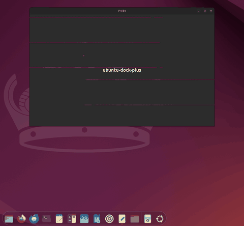
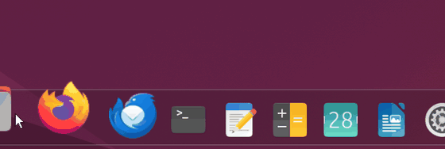
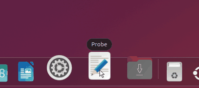
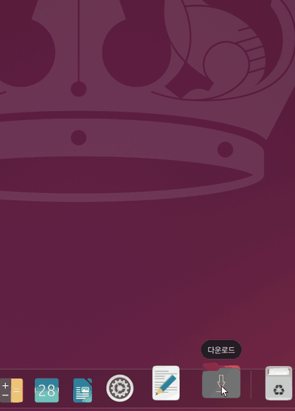
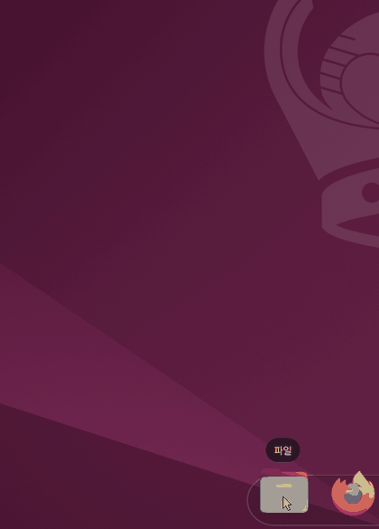
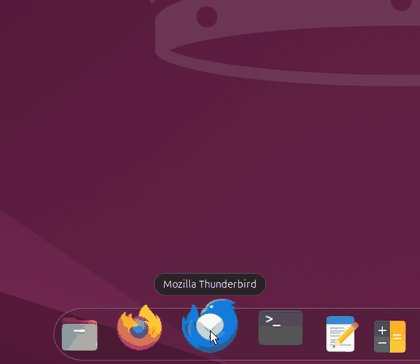
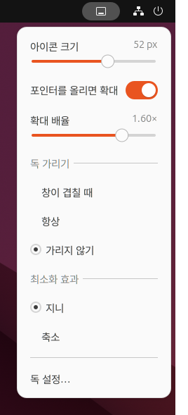
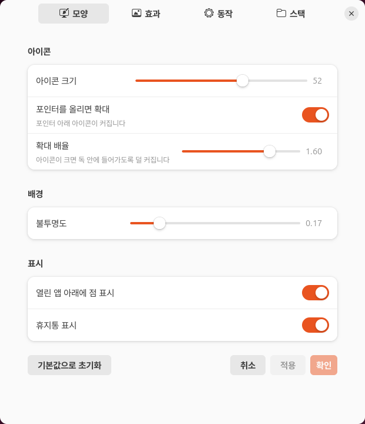

# ubuntu-dock-plus

우분투 독(Ubuntu Dock)을 macOS 독처럼 움직이게 합니다. 상단바 메뉴와 설정 창에서 효과를 바로 조절할 수 있습니다. 우분투 24.04(GNOME 46, X11)에서 확인했습니다.



## 설치

```bash
git clone https://github.com/GyoungTaeChae/ubuntu-dock-plus.git
cd ubuntu-dock-plus
sh install.sh
```

설치한 뒤에는 GNOME Shell을 한 번 다시 시작해야 합니다. X11에서는 `Alt` + `F2`를 누르고 `r`을 입력한 뒤 Enter를 누르면 됩니다. 한글 입력 상태에서는 `r`이 들어가지 않으니, 먼저 한/영 키로 영문으로 바꿔 주세요. Wayland에서는 로그아웃했다가 다시 로그인합니다.

sudo는 필요 없고, 홈 폴더 밖은 건드리지 않습니다.

## 사용법

### 확대
독 위에 포인터를 올리면 아이콘이 커지고, 옆 아이콘들이 자리를 비켜 줍니다.



### 바운스
앱을 누르면 창이 뜰 때까지 아이콘이 통통 튑니다. 실행 중인 앱을 누를 때와 앱이 알림을 보낼 때도 튀고, 셋 다 설정 창에서 따로 끌 수 있습니다.



### 지니
창을 최소화하면 창이 독 아이콘으로 빨려 들어가고, 다시 열면 아이콘에서 흘러나옵니다. 맨 위 그림이 이 효과입니다. 상단바 메뉴에서 GNOME 기본 효과(축소)로 바꿀 수 있습니다.

### 다운로드 스택
독의 다운로드 아이콘을 누르면 가장 최근 파일 10개가 부채꼴로 펼쳐집니다. 독에 가장 가까운 칸이 가장 최근 파일입니다. 파일을 누르면 그 파일이 열리고, 맨 위 `파일에서 열기`를 누르면 다운로드 폴더 전체가 열립니다. `Esc`를 누르거나 빈 곳을 누르면 닫힙니다.



### 파일 스택
파일 창이 하나도 없을 때 파일 아이콘을 누르면 홈, 데스크톱, 문서, 다운로드, 사진, 책갈피가 펼쳐집니다. 파일 창이 열려 있으면 평소처럼 동작합니다.



### 끌어서 지우기
고정한 앱 아이콘을 독 밖으로 끌어내 잠시 들고 있으면 위에 `제거`가 뜹니다. 그때 놓으면 연기와 함께 독에서 빠집니다. `제거`가 뜨기 전에 놓거나 독 위에서 놓으면 그대로 남고, 독 안에서 끌면 순서만 바뀝니다.



### 상단바 메뉴
상단바의 독 아이콘을 누르면 아이콘 크기, 확대 배율, 독 가리기, 최소화 효과를 바로 바꿀 수 있습니다. `독 설정…`을 누르면 설정 창이 열립니다.



### 설정 창
모양, 효과, 동작, 스택 네 쪽으로 나뉩니다. 쪽마다 아래에 `기본값으로 초기화`, `취소`, `적용`, `확인`이 있습니다. 창에서 바꾼 값은 `적용`이나 `확인`을 눌러야 저장되고, `취소`를 누르거나 창을 닫으면 버려집니다. `기본값으로 초기화`도 `적용`을 눌러야 저장됩니다.



| 쪽 | 항목 | 설치한 값 |
|---|---|---|
| 모양 | 아이콘 크기 (32–64 px) | 52 px |
| | 포인터를 올리면 확대, 확대 배율 (1.0–1.8배, 아이콘이 크면 독 안에 맞게 덜 커짐) | 켬, 1.6배 |
| | 불투명도 | 0.17 |
| | 열린 앱 아래에 점 표시, 휴지통 표시 | 켬, 켬 |
| 효과 | 최소화 효과 (지니·축소), 지니 시간 (200–1500 ms) | 지니, 550 ms |
| | 실행할 때·누를 때·알림이 올 때 튀기, 튀는 높이 (8–40 px) | 모두 켬, 22 px |
| 동작 | 독 가리기 (창이 겹칠 때·항상·가리지 않기) | 창이 겹칠 때 |
| | 실행 중인 앱 아이콘을 누르면 (최소화하거나 앞으로·앞으로만) | 최소화하거나 앞으로 |
| 스택 | 보기 방식 (부채꼴·격자), 다운로드 정렬 (최근 항목 먼저·이름) | 부채꼴, 최근 항목 먼저 |

## 지우기

```bash
sh uninstall.sh
```

확장과 다운로드 아이콘을 지우고, 바꾼 설정을 설치 전 값으로 되돌립니다. 그다음 GNOME Shell을 다시 시작해 주세요.

## 폴더 구성

| 폴더 | 내용 |
|---|---|
| `extension/` | 설치되는 확장. Dock Glass(aace980)에 이 저장소의 기능을 더한 소스입니다. |
| `tools/` | `build.sh`(설정 스키마·번역을 묶어 확장 폴더를 만듭니다), `po2mo.py`(msgfmt 없이 번역을 만듭니다) |
| `docs/` | README의 그림 |

## 라이선스

GPL-3.0-or-later

독 효과는 atarico의 [Dock Glass](https://github.com/atarico/dock-glass)(GPL-3.0, aace980)가 바탕입니다. 이 저장소는 2026-11-24에 Dock Glass를 고쳐 다운로드 스택, 설정(GSettings), 상단바 메뉴, 설정 창, 클릭·알림 바운스, 끌어서 지우기를 더했습니다. 고친 파일의 머리에 고친 내용을 적어 두었습니다. 원본과의 차이는 Dock Glass 저장소의 aace980 커밋과 `extension/`을 비교하면 볼 수 있습니다.
